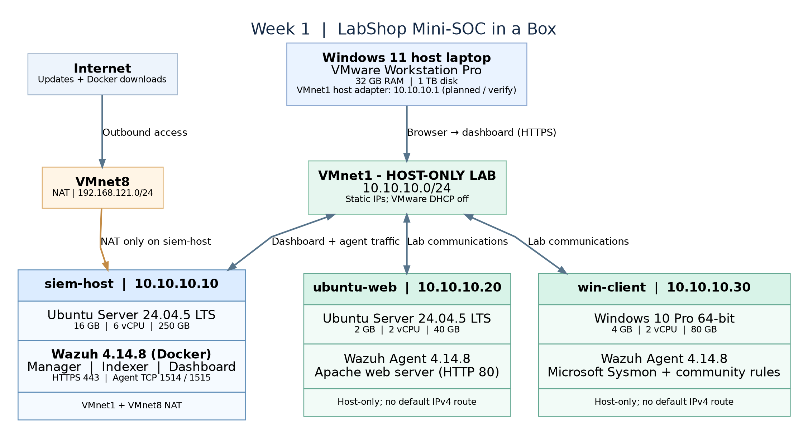

# Mini-SOC in a Box

**A hands-on, two-week Blue Team / SOC lab built in an isolated VMware environment.**

This project documents a small Security Operations Center powered by **Wazuh 4.14.8**, with Linux and Windows endpoint telemetry, custom detection rules, **Suricata IDS**, file integrity monitoring (FIM), and security assessment.

**Explore:** [Week 1 — Infrastructure](week1/README.md) · [Week 2 — Detection & Hardening](week2/README.md) · [Evidence](week2/evidence/README.md)

## Lab architecture



All machines communicate over **VMnet1, 10.10.10.0/24 (host-only)**. The SIEM host also has a NAT adapter for maintenance; the Linux web server and Windows workstation are isolated from the Internet during final testing.

| Virtual machine | Host-only IP | Role | Main software |
| :-- | :-- | :-- | :-- |
| **siem-host** | `10.10.10.10` | Central security monitoring | Wazuh Manager, Indexer & Dashboard 4.14.8 (Docker) |
| **ubuntu-web** | `10.10.10.20` | Linux server and network sensor | Ubuntu Server 24.04.5 LTS, Apache2, Wazuh agent, Suricata 7.0.3 |
| **win-client** | `10.10.10.30` | Windows telemetry and FIM | Windows 10 Pro, Wazuh agent, Sysmon |

**Event flow:** Endpoint / network event → Wazuh agent → Wazuh Manager (decoding and correlation) → Indexer → Dashboard.

## Project milestones

| Phase | Focus | Verified outcomes | Details |
| :-- | :-- | :-- | :-- |
| **Week 1** | SOC infrastructure & visibility | Three VMs, Wazuh deployment, Linux/Windows agents, Sysmon, security event testing, reboot/persistence checks | [Week 1 walkthrough](week1/README.md) |
| **Week 2** | Detection engineering & assessment | LabShop authentication rules, brute-force correlation, Linux/Windows FIM, Windows Registry monitoring, Suricata integration, CIS hardening, vulnerability review | [Week 2 walkthrough](week2/README.md) |

### Week 1 — Build the SOC

Configured the virtual network and deployed the **Wazuh single-node stack** using Docker. Connected the Linux and Windows endpoints, collected Sysmon and authentication events, and verified that the stack and indexed alerts survived a reboot.

[Detailed setup and results](week1/README.md) · [Week 1 evidence](evidence/README.md) · [Build journal](journal.md)

### Week 2 — Detect and investigate

- **Custom Wazuh rules:** Single LabShop login failure (**100102**, level 5) and five failures from one IP in 60 seconds (**100103**, level 12; MITRE **T1110**).
- **File integrity monitoring:** Created (**554**), modified (**550**) and deleted (**553**) files detected on Linux and Windows; scheduled Windows Registry modification detected with rule **750**.
- **Suricata IDS:** Custom HTTP `/admin` signature (**SID 1000001**) forwarded through `eve.json`, triggering Wazuh rule **100110** (level 10). A normal `/` request served as the negative test.
- **Security assessment:** Two Ubuntu CIS checks remediated, and Wazuh vulnerability inventories reviewed for both endpoints.
- **Recovery points:** `w2-start` and `w2-done` VMware snapshots created for all three VMs.

[Week 2 evidence](week2/evidence/README.md) · [Detection configurations](week2/config/README.md) · [SCA and CVE findings](week2/findings.md) · [Troubleshooting](week2/troubleshooting.md)

## Assessment results

| CIS SCA scan | Passed | Failed | N/A | Score |
| :-- | --: | --: | --: | --: |
| Ubuntu 24.04 — **before** remediation | 119 | 118 | 42 | 50% |
| Ubuntu 24.04 — **after** remediation | **121** | **116** | 42 | **51%** |
| Windows 10 Enterprise benchmark on Windows 10 Pro | 116 | 303 | 5 | 27% |

The Ubuntu improvement came from correcting local and remote warning banners (**checks 35547 and 35548**). The two benchmarks cover different systems and should not be compared as direct measurements of overall security.

## Repository guide

```text
mini-soc-in-a-box/
├── README.md                         # Project homepage (this file)
├── week1/README.md                   # Week 1 detailed guide
├── week2/
│   ├── README.md                     # Week 2 detailed guide
│   ├── config/                       # Custom Wazuh and Suricata rules
│   ├── evidence/                     # Week 2 screenshots
│   ├── findings.md                   # CIS and CVE results
│   ├── troubleshooting.md            # Issues and solutions
│   └── report/                       # A4 Word report
├── architecture/                     # Lab diagram, IPs and event flow
├── evidence/                         # Original Week 1 screenshots
├── journal.md                        # Week 1 implementation journal
└── scripts/                          # Repository validation script
```

The original Week 1 evidence and architecture remain at the repository root to preserve their existing links.

## Start the lab

Start `siem-host` in VMware, then confirm the existing Wazuh Docker stack is running:

```bash
cd ~/wazuh-docker/single-node
sudo docker compose ps
```

Then start `ubuntu-web` and `win-client`, and open **`https://10.10.10.10`** from the host computer. For the full setup, start/stop instructions and troubleshooting, see the [Week 1 runbook](week1/README.md).

> **Lab-only notice:** The environment uses private addressing and self-signed certificates and is not hardened for Internet exposure. No passwords, private keys, full credential-bearing Docker configurations or VM disk images are intended for publication.
