# Week 2 — Detection Engineering, File Integrity Monitoring & Security Assessment

> **Mini-SOC in a Box / LabShop SOC** · Wazuh 4.14.8 · Suricata 7.0.3 · VMware Workstation Pro  
> A practical continuation of the [Week 1 infrastructure build](../README.md), with custom detections, controlled test events, troubleshooting, and evidence from both monitored endpoints.

## Overview

During Week 1, I deployed a Wazuh-based SOC on an isolated VMware network. In Week 2, I extended it with **custom application-log decoding, brute-force correlation, file and Registry integrity monitoring, Suricata IDS, CIS Security Configuration Assessment, and CVE review**. Each detection was tested and verified in the Wazuh Dashboard.

**Quick navigation:** [Environment](#1-environment-and-service-checks) · [Custom Wazuh rules](#2-custom-application-log-detection) · [Linux FIM](#3-linux-file-integrity-monitoring) · [Windows FIM](#4-windows-file-and-registry-integrity-monitoring) · [Scheduled FIM](#5-scheduled-vs-real-time-fim) · [Suricata](#6-suricata-network-ids-and-wazuh-integration) · [SCA](#7-security-configuration-assessment-sca) · [Vulnerabilities](#8-vulnerability-assessment) · [Troubleshooting](#9-troubleshooting-summary) · [Snapshots](#10-final-validation-and-vmware-snapshots)

### Lab architecture

| System | Host-only IP | Main role and software |
| --- | --- | --- |
| `siem-host` | `10.10.10.10` | Ubuntu Server; Docker-hosted Wazuh Manager, Indexer and Dashboard **4.14.8** |
| `ubuntu-web` | `10.10.10.20` | Ubuntu Server 24.04.5; Apache, Wazuh agent and Suricata **7.0.3** |
| `win-client` | `10.10.10.30` | Windows 10 Pro; Wazuh agent **4.14.8** and Sysmon |

All security tests were performed inside the user-owned **VMnet1 host-only network, `10.10.10.0/24`**. The Ubuntu and Windows endpoints do not retain a default IPv4 route; `siem-host` uses VMnet8 NAT for update access. This is a training environment, not a production-ready SOC deployment.

---

## 1. Environment and service checks

Before making changes, I checked that Wazuh's Docker containers were running on `siem-host` and that the agents and services were active on both endpoints.

**On `siem-host`:**

```bash
hostname -I
cd ~/wazuh-docker/single-node
sudo docker compose ps
```

The Manager, Indexer, and Dashboard containers were running. The host-only IP was `10.10.10.10`.

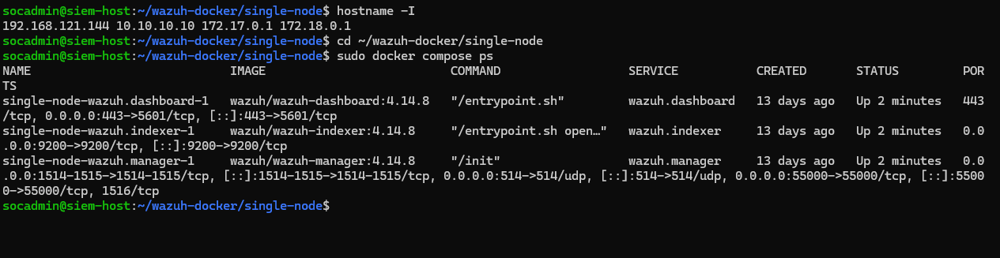

**On `ubuntu-web`:**

```bash
hostname -I
ip -br a
sudo systemctl is-active wazuh-agent
sudo systemctl is-active apache2
free -h
```

The web server and Wazuh agent were active on `10.10.10.20`.

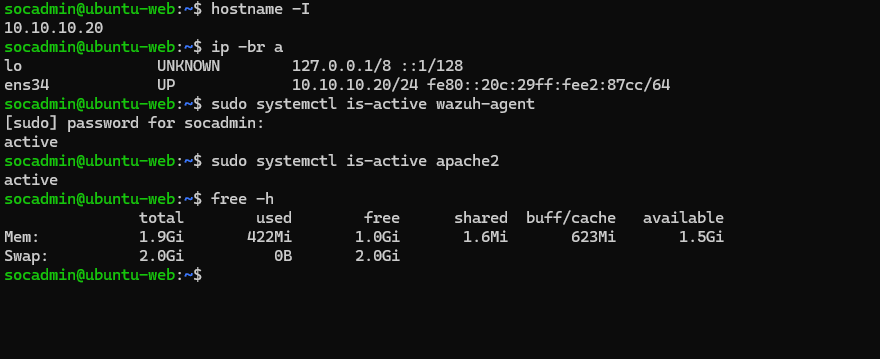

On Windows, I confirmed that **WazuhSvc** and **Sysmon64** were running and that the workstation's host-only address was `10.10.10.30`.

---

## 2. Custom application-log detection

### 2.1 Collect LabShop authentication events

On `ubuntu-web`, I created a dedicated application log file and added it to the Wazuh agent's log collection configuration.

```bash
sudo mkdir -p /var/log/labshop
sudo touch /var/log/labshop/app.log
sudo cp /var/ossec/etc/ossec.conf /var/ossec/etc/ossec.conf.w2-start.bak
sudo nano /var/ossec/etc/ossec.conf
```

Inside the existing `<ossec_config>` element, the new collection block was:

```xml
<localfile>
  <log_format>syslog</log_format>
  <location>/var/log/labshop/app.log</location>
</localfile>
```

I validated the configuration, restarted the agent and checked its internal log to confirm the application file was being monitored.

```bash
sudo /var/ossec/bin/wazuh-logcollector -t
sudo systemctl restart wazuh-agent
sudo tail -n 30 /var/ossec/logs/ossec.log
```

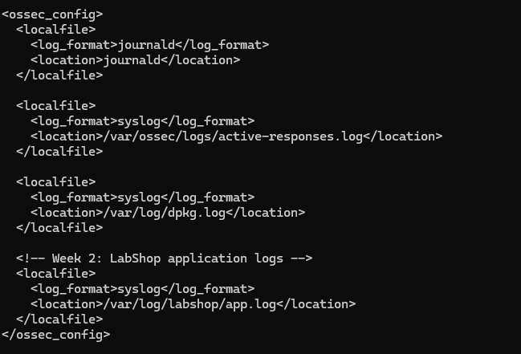

### 2.2 Write and test a custom decoder

The custom **`labshop`** decoder was installed in the Wazuh Manager at `/var/ossec/etc/decoders/labshop_decoder.xml`. It parsed syslog-format authentication records and extracted the fields `action`, `dstuser` and `srcip`.

Representative event used in testing:

```text
Oct 22 10:15:01 ubuntu-web labshop[2521]: LOGIN_FAILED user=admin src=10.10.10.50
```

I used `wazuh-logtest` to verify parsing before testing the alert rules:

```bash
sudo docker exec -it single-node-wazuh.manager-1 \
  /var/ossec/bin/wazuh-logtest
```

The decoder identified `LOGIN_FAILED`, `admin` and `10.10.10.50` correctly. The original decoder XML has **not** been uploaded as a sanitized source file, so the screenshot records the verified result without inventing a replacement decoder.

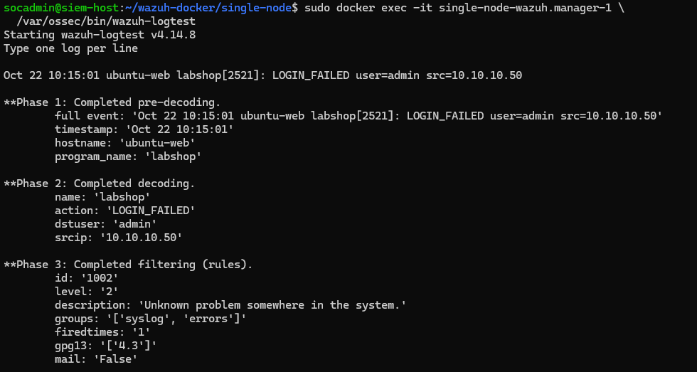

### 2.3 Create individual-login and brute-force rules

I installed two custom Manager rules in `/var/ossec/etc/rules/labshop_rules.xml`:

| Rule | Level | Purpose |
| --- | ---: | --- |
| **100102** | **5** | A single failed LabShop login, excluding the `monitor` account |
| **100103** | **12** | Five failed logins from **one source IP** in **60 seconds**; maps to MITRE ATT&CK **T1110** |

The key rule elements are shown below (the full file is in [`config/rules/labshop_rules.xml`](config/rules/labshop_rules.xml)):

```xml
<rule id="100102" level="5">
  <decoded_as>labshop</decoded_as>
  <field name="action" type="pcre2">^LOGIN_FAILED$</field>
  <user negate="yes" type="pcre2">^monitor$</user>
  <description>LabShop: Failed login for $(dstuser) from $(srcip)</description>
  <group>authentication_failed,</group>
</rule>

<rule id="100103" level="12" frequency="5" timeframe="60">
  <if_matched_sid>100102</if_matched_sid>
  <same_srcip />
  <description>LabShop: Possible brute-force attack from $(srcip)</description>
  <mitre><id>T1110</id></mitre>
  <group>authentication_failures,brute_force,</group>
</rule>
```

After copying the file to the Manager, `wazuh-analysisd -t` returned exit code **0**. An earlier attempt failed because it used an invalid static `action` field; changing it to `<field name="action" ...>` solved the problem.

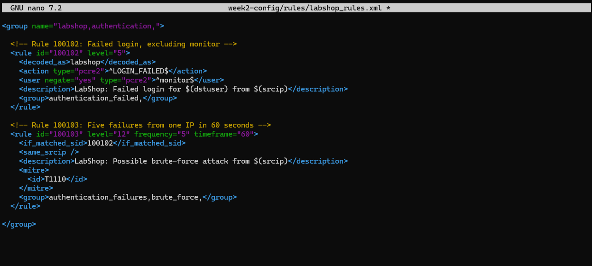

### 2.4 Verify the detections

A single failed login generated alert **100102 / level 5**. In a repeated test, the fifth failure from the same source generated **100103 / level 12** with ATT&CK **T1110**. A failed login from `monitor` did not match our custom login rule.

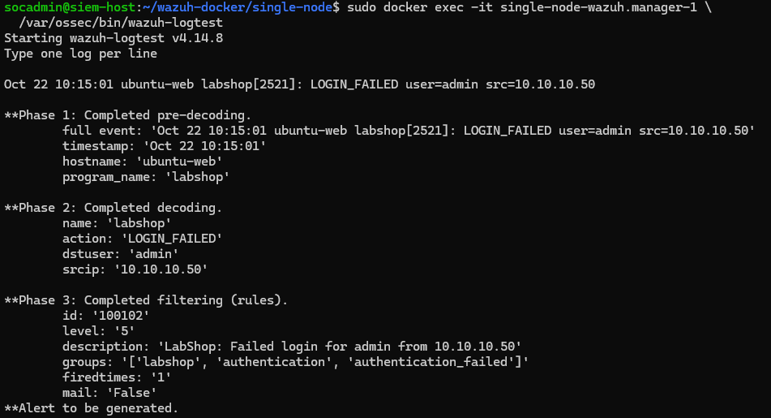

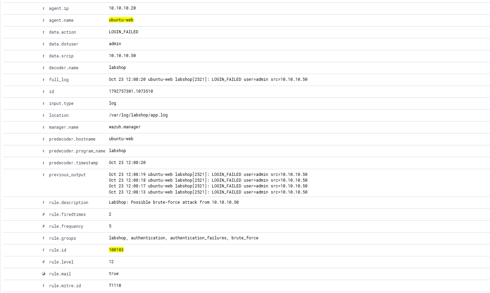

**Important:** The six-line manual test also demonstrated that different source IPs must be counted independently. When testing via `wazuh-logtest`, each event must be entered as a separate complete line, not accidentally concatenated.

---

## 3. Linux file integrity monitoring

### 3.1 Configure real-time monitoring of Apache files

On `ubuntu-web`, I enabled real-time FIM for Apache's document root in the agent's existing `<syscheck>` section:

```xml
<directories check_all="yes" realtime="yes" report_changes="yes">/var/www/html</directories>
```

I validated the configuration and restarted the Wazuh agent. The internal log confirmed real-time monitoring of `/var/www/html`.

```bash
sudo /var/ossec/bin/wazuh-syscheckd -t
sudo systemctl restart wazuh-agent
sudo grep 'Real-time file integrity monitoring' /var/ossec/logs/ossec.log | tail
```

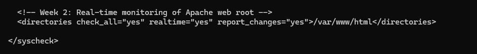

### 3.2 Test file creation, modification and deletion

I created the harmless test file `/var/www/html/w2-fim-test.txt`, changed its contents, and removed it. Wazuh Discover confirmed all three operations:

| Operation | Wazuh rule | Description |
| --- | --- | --- |
| Create | **554**, level 5 | File added to the system |
| Modify | **550**, level 7 | Integrity checksum changed; old/new content shown in `syscheck.diff` |
| Delete | **553**, level 7 | File deleted |

```bash
echo 'Week 2 FIM test - original content' | sudo tee /var/www/html/w2-fim-test.txt
echo 'Week 2 FIM test - MODIFIED content' | sudo tee /var/www/html/w2-fim-test.txt
sudo rm /var/www/html/w2-fim-test.txt
```

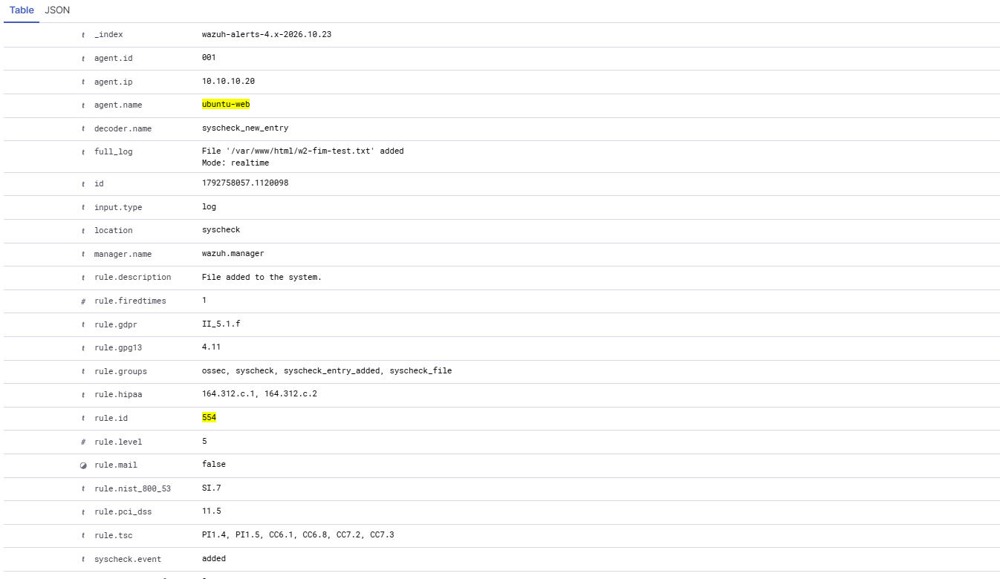

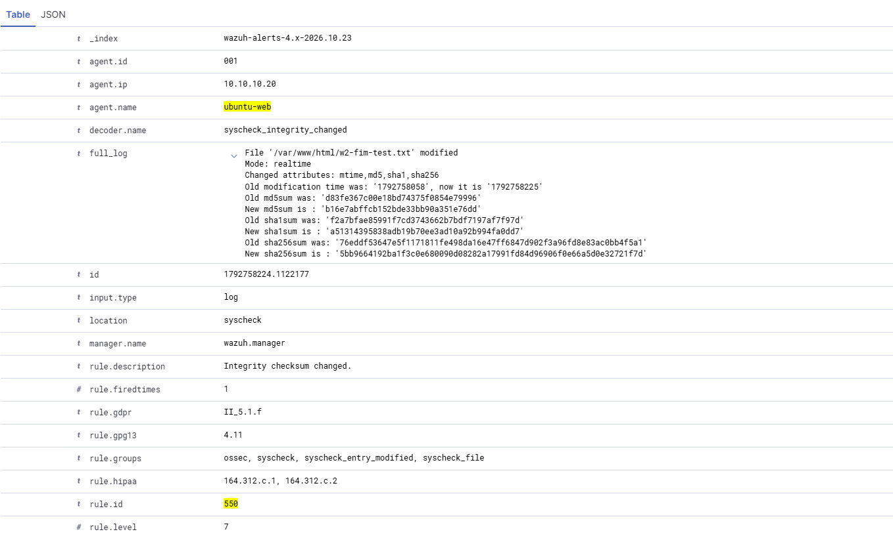

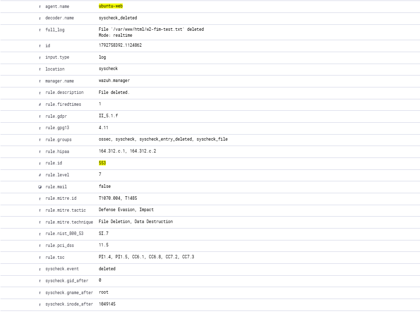

---

## 4. Windows file and Registry integrity monitoring

### 4.1 Prepare monitored targets

In an elevated PowerShell terminal on `win-client`, I created `C:\LabShopData` and the test registry key `HKLM:\SOFTWARE\LabShop`. The Registry value `Mode` initially contained `baseline`.

```powershell
New-Item -Path 'C:\LabShopData' -ItemType Directory -Force
New-Item -Path 'HKLM:\SOFTWARE\LabShop' -Force
New-ItemProperty -Path 'HKLM:\SOFTWARE\LabShop' -Name Mode -Value 'baseline' -PropertyType String -Force
```

I backed up the Wazuh agent configuration before editing it:

```powershell
$cfg = 'C:\Program Files (x86)\ossec-agent\ossec.conf'
Copy-Item $cfg "$cfg.w2-fim.bak"
notepad $cfg
```

### 4.2 Configure real-time files and scheduled Registry scans

Inside the agent's existing `<syscheck>` element, the settings were:

```xml
<frequency>300</frequency>
<directories check_all="yes" realtime="yes" report_changes="yes">C:\LabShopData</directories>
<windows_registry arch="64bit" report_changes="yes">HKEY_LOCAL_MACHINE\SOFTWARE\LabShop</windows_registry>
```

The folder is monitored **in real time**; the Registry is checked on the **300-second scheduled FIM interval**. After restarting `WazuhSvc`, the agent reported that its FIM module had started.

```powershell
Restart-Service WazuhSvc
Get-Service WazuhSvc
Get-Content 'C:\Program Files (x86)\ossec-agent\ossec.log' -Tail 25
```

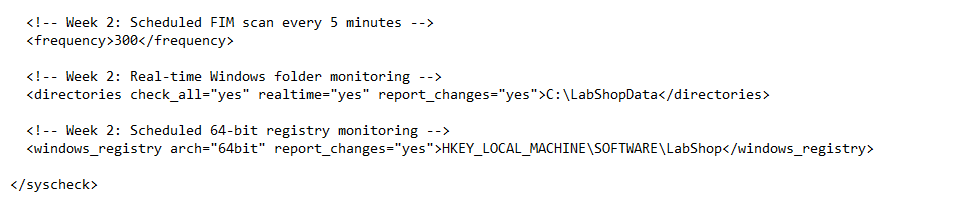

### 4.3 Test Windows file operations

I created, modified and deleted `C:\LabShopData\w2-fim-test.txt`. Wazuh generated rules **554**, **550** and **553**, and the modification record displayed the original and modified text.

```powershell
'Week 2 FIM test - original content' | Set-Content 'C:\LabShopData\w2-fim-test.txt' -Encoding UTF8
'Week 2 FIM test - MODIFIED content' | Set-Content 'C:\LabShopData\w2-fim-test.txt' -Encoding UTF8
Remove-Item 'C:\LabShopData\w2-fim-test.txt'
```

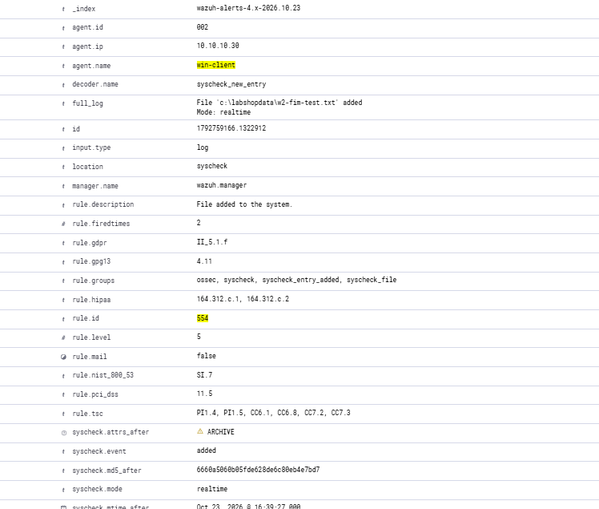

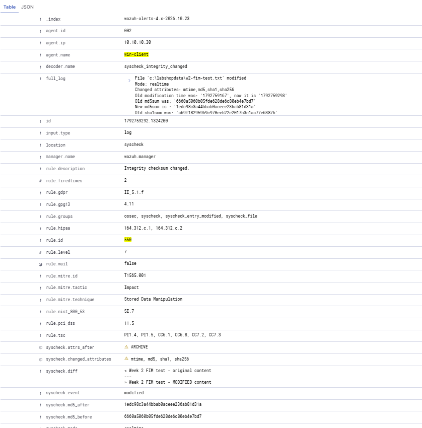

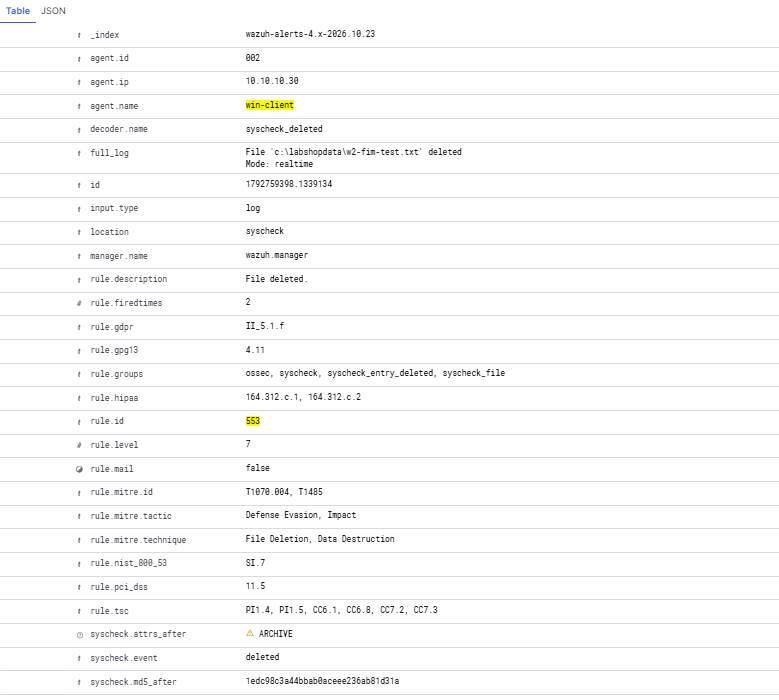

### 4.4 Detect a Registry value change

I changed the `Mode` value from `baseline` to `modified`:

```powershell
Set-ItemProperty -Path 'HKLM:\SOFTWARE\LabShop' -Name Mode -Value 'modified'
Get-ItemProperty -Path 'HKLM:\SOFTWARE\LabShop' -Name Mode
```

The scheduled scan detected the Registry modification as **rule 750 / level 5**. It did not appear immediately because Registry monitoring used a periodic scan rather than the real-time directory watcher.

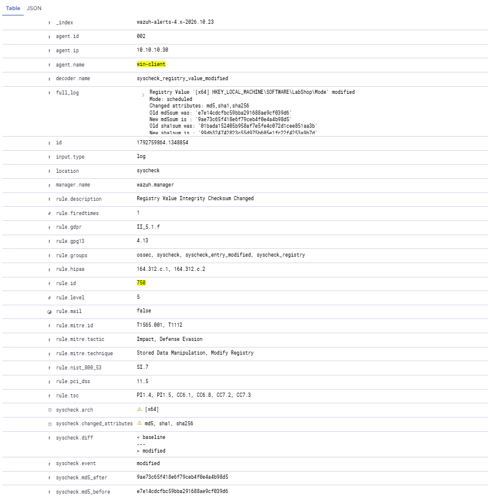

---

## 5. Scheduled vs. real-time FIM

To demonstrate the difference from real-time monitoring, I modified a harmless file under Ubuntu's `/etc` directory while it was covered by a scheduled FIM scan.

The normal scan interval was **43,200 seconds (12 hours)**. For a short lab test I temporarily changed the interval to **60 seconds**, restarted the agent, modified `/etc/labshop-week2-scheduled.conf`, and confirmed **rule 550** with `syscheck.mode: scheduled`.

```bash
# Inside the existing <syscheck> element of /var/ossec/etc/ossec.conf:
# <frequency>60</frequency>

sudo /var/ossec/bin/wazuh-syscheckd -t
sudo systemctl restart wazuh-agent

echo 'LabShop scheduled FIM test - baseline' | sudo tee /etc/labshop-week2-scheduled.conf
echo 'LabShop scheduled FIM test - MODIFIED' | sudo tee /etc/labshop-week2-scheduled.conf
```

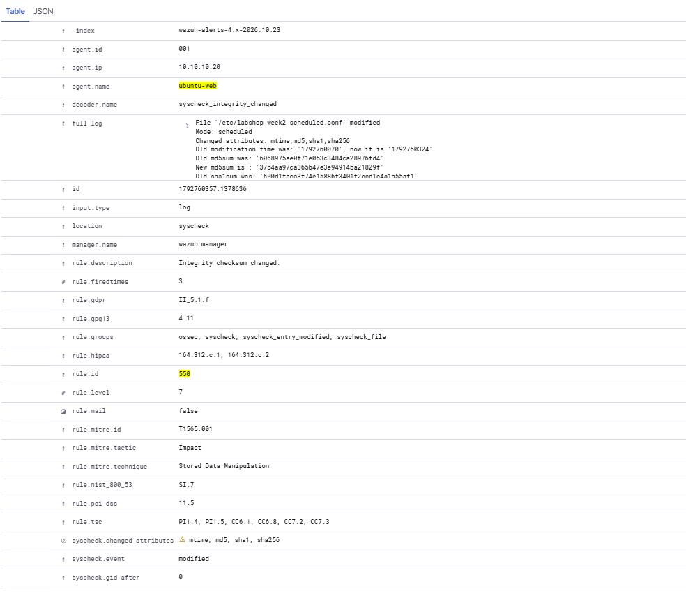

After proving the detection, I restored the original **43,200-second** interval and confirmed it in the agent log. The 60-second interval was for testing only, not the final configuration.

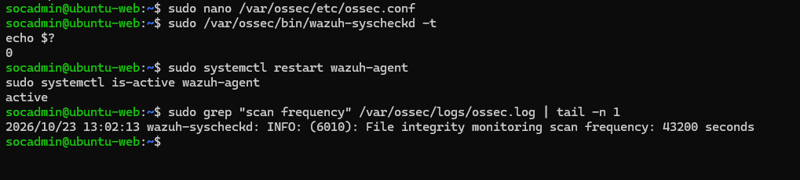

---

## 6. Suricata network IDS and Wazuh integration

### 6.1 Install Suricata and resolve startup problems

I temporarily provided update access to `ubuntu-web`, installed Suricata and `jq`, and confirmed **Suricata 7.0.3**.

```bash
sudo apt update
sudo apt install -y suricata jq
suricata -V
```

The service initially **failed** because the default AF_PACKET configuration referenced `eth0`, which was not present on this VM. The host-only interface was **`ens34`**.

```bash
ip -br a
sudo journalctl -u suricata -b -n 60 --no-pager
sudo grep -A 6 '^af-packet:' /etc/suricata/suricata.yaml
```

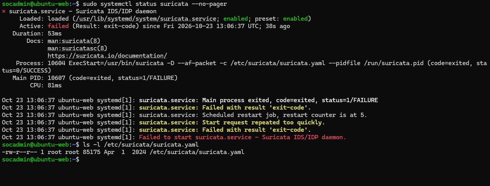

I backed up `/etc/suricata/suricata.yaml` and changed the existing AF_PACKET configuration to use `ens34`.

```yaml
af-packet:
  - interface: ens34
```

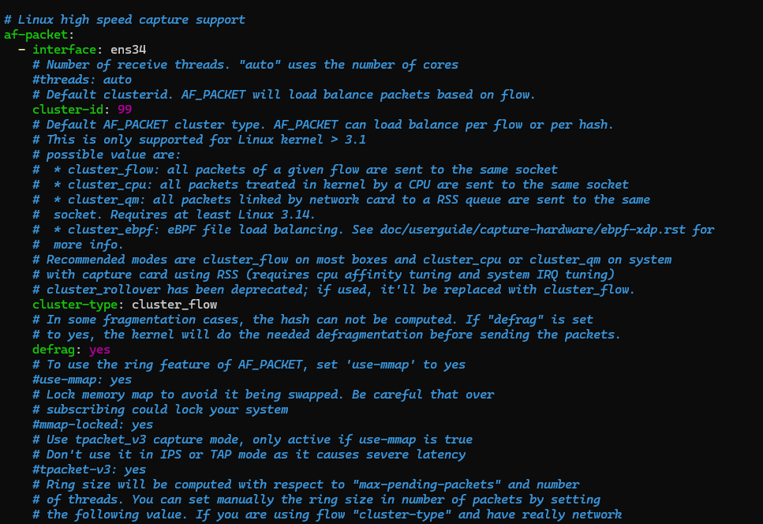

### 6.2 Create a local HTTP detection rule

I wrote a custom Suricata signature that detects requests containing `/admin` in the HTTP URI sent to the lab Apache server.

**File:** [`config/suricata/labshop.rules`](config/suricata/labshop.rules), deployed at `/etc/suricata/rules/labshop.rules`.

```suricata
alert http any any -> 10.10.10.20 80 (msg:"LABSHOP: HTTP admin path probe detected"; flow:established,to_server; http.uri; content:"/admin"; nocase; sid:1000001; rev:1;)
```

I configured the existing `rule-files` section in `suricata.yaml` to include `/etc/suricata/rules/labshop.rules` and tested the configuration:

```bash
sudo suricata -T -c /etc/suricata/suricata.yaml -v
sudo systemctl reset-failed suricata
sudo systemctl restart suricata
sudo systemctl is-active suricata
```

Suricata successfully loaded **one custom signature**, with no failed signatures, and the service became active.

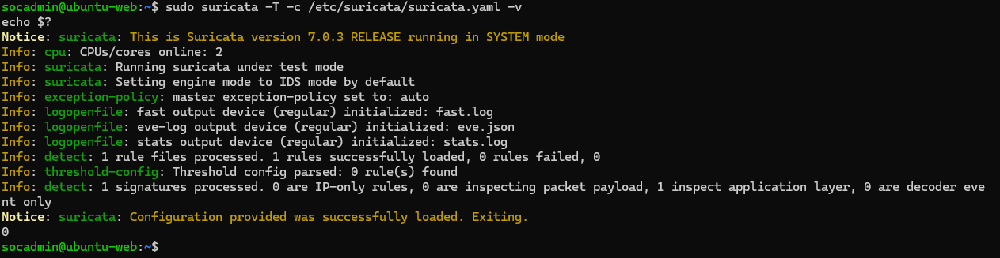

### 6.3 Generate a controlled HTTP request

From the Windows host, I requested `/admin` on the internal web server:

```powershell
curl.exe -i http://10.10.10.20/admin
curl.exe -i http://10.10.10.20/
```

Apache returned **404** for `/admin`, but Suricata still detected the attempted access; IDS detection does not require a successful page response. The normal `/` request returned **200** and did not generate another alert for the `/admin` signature.

I verified the signature in Suricata's local logs:

```bash
sudo tail -n 15 /var/log/suricata/fast.log
sudo jq -c 'select(.event_type=="alert" and .alert.signature_id==1000001)' \
  /var/log/suricata/eve.json | tail -n 5
```

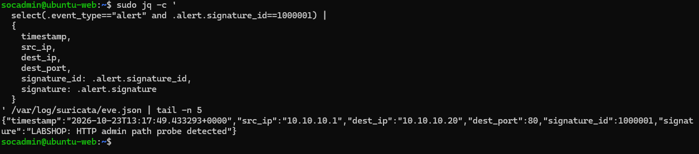

### 6.4 Forward Suricata JSON into Wazuh

On `ubuntu-web`, I added Suricata's EVE JSON log to the Wazuh agent:

```xml
<localfile>
  <log_format>json</log_format>
  <location>/var/log/suricata/eve.json</location>
</localfile>
```

I validated the Wazuh configuration and restarted the agent. Its log confirmed it was analyzing `/var/log/suricata/eve.json`.

### 6.5 Raise a dedicated Wazuh alert

On `siem-host`, I deployed [`config/rules/labshop_suricata_rules.xml`](config/rules/labshop_suricata_rules.xml). The rule matches Suricata signature **1000001** and assigns it **Wazuh rule 100110, level 10**.

```xml
<rule id="100110" level="10">
  <if_sid>86601</if_sid>
  <field name="alert.signature_id" type="pcre2">^1000001$</field>
  <description>LabShop: HTTP admin probe detected from $(src_ip) to $(dest_ip)</description>
  <group>web_probe,</group>
</rule>
```

```bash
sudo docker exec single-node-wazuh.manager-1 /var/ossec/bin/wazuh-analysisd -t
sudo docker compose restart wazuh.manager
```

Wazuh logtest returned the expected **100110 / level 10**, and a new live HTTP request created the same alert in Discover.

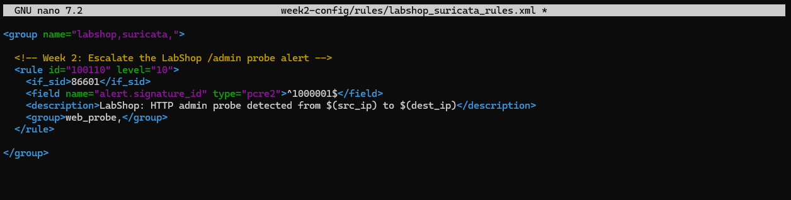

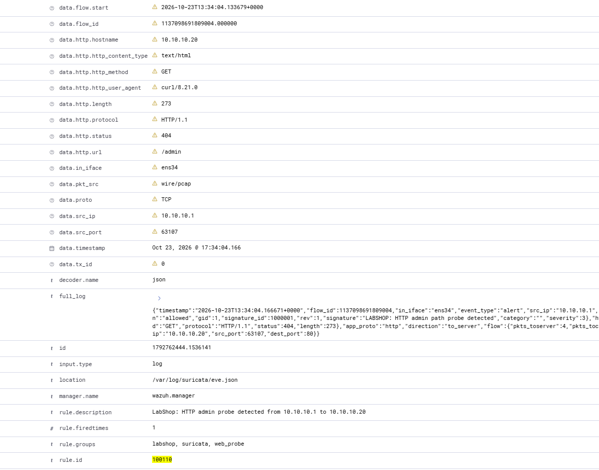

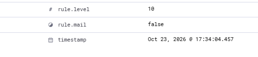

### 6.6 Restore endpoint isolation

After installing and testing Suricata, I removed the temporary NAT adapter from `ubuntu-web`. The final host showed only `ens34` with **`10.10.10.20/24`**, no default IPv4 route, and active Suricata, Wazuh-agent and Apache services.

Suricata's service memory was approximately **45.8 MiB**, and the Ubuntu VM had about **1.4 GiB available RAM**.

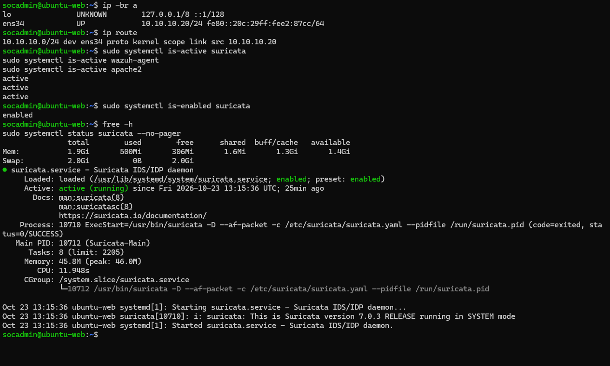

---

## 7. Security Configuration Assessment (SCA)

### 7.1 Record the Ubuntu CIS baseline

I opened **Configuration Assessment** for `ubuntu-web` and selected the **CIS Ubuntu Linux 24.04 LTS Benchmark v1.0.0**. Its first scan reported **119 passed**, **118 failed**, **42 not applicable** — **50%** compliance.

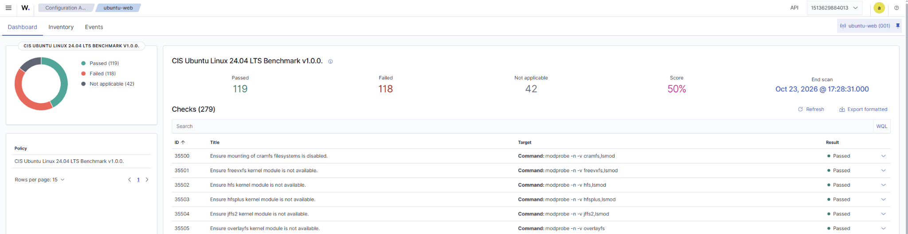

### 7.2 Remediate two low-risk failures

The failed checks **35547** and **35548** concerned the local and remote login banner contents (`/etc/issue` and `/etc/issue.net`). Both files already had correct **root:root / 644** ownership and permissions; I only changed their displayed text.

```bash
sudo cp -a /etc/issue /etc/issue.w2-before-sca.bak
sudo cp -a /etc/issue.net /etc/issue.net.w2-before-sca.bak

printf '%s\n' 'Authorized users only. LabShop SOC training environment. Activity may be monitored and logged.' \
  | sudo tee /etc/issue /etc/issue.net

stat -c '%n | %U:%G | %a' /etc/issue /etc/issue.net
sudo systemctl restart wazuh-agent
```

The next scan showed **both checks as Passed**. Changing `/etc/issue.net` did not configure an OpenSSH login banner; SSH configuration was deliberately left unchanged.

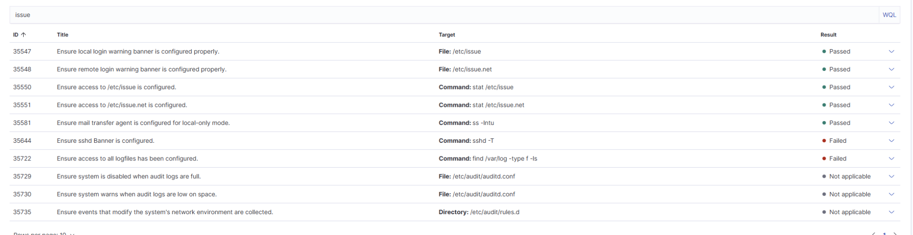

### 7.3 Verify the new compliance score

| Ubuntu SCA | Before | After |
| --- | ---: | ---: |
| Passed | 119 | **121** |
| Failed | 118 | **116** |
| Not applicable | 42 | 42 |
| Overall score | 50% | **51%** |

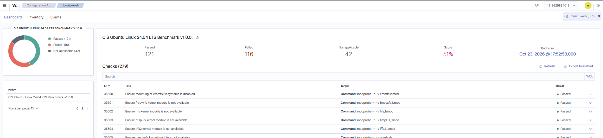

I intentionally left check **35510** (separate `/tmp` partition) unremediated because repartitioning an existing VMware test image adds unnecessary disruption. This was recorded as an accepted lab limitation rather than hidden.

### 7.4 Record the Windows CIS baseline

On `win-client`, the **CIS Microsoft Windows 10 Enterprise Benchmark v4.0.0** reported **116 passed**, **303 failed**, **5 not applicable**, and **27%** compliance across 424 checks.

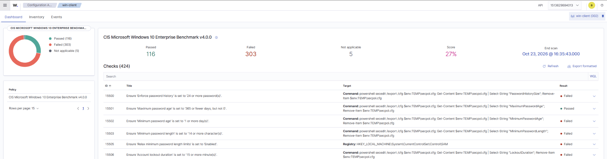

**Interpretation:** The machine runs Windows 10 **Pro**, while the selected benchmark targets **Enterprise**. Consequently, some failed settings may be edition-dependent. The Ubuntu and Windows scores come from different benchmarks and should not be compared as direct security rankings.

---

## 8. Vulnerability assessment

I opened **Vulnerability Detection → Inventory** for each agent, filtered to **Critical**, and sorted by `vulnerability.score.base` descending. This was an inventory/risk-review exercise; **no vulnerability patches were applied**.

| Agent | All vulnerability inventory hits | Critical inventory hits |
| --- | ---: | ---: |
| `ubuntu-web (001)` | **3,858** | **184** |
| `win-client (002)` | **2,842** | **60** |

### 8.1 Ubuntu — highest-scoring selected CVEs

The affected package was `linux-image-6.8.0-146-generic`, installed version **6.8.0-146.146**.

| CVE | Wazuh CVSS v3.1 | Brief description |
| --- | ---: | --- |
| [CVE-2026-74705](https://ubuntu.com/security/CVE-2026-74705) | **10.0** | Potential use-after-free in UDP tunnel segmentation |
| [CVE-2026-74612](https://ubuntu.com/security/CVE-2026-74612) | **10.0** | Virtual Ethernet/XDP buffer-length handling may cause memory disclosure or corruption |
| [CVE-2026-63795](https://ubuntu.com/security/CVE-2026-63795) | **10.0** | Linux kernel 9p filesystem memory-safety issue |

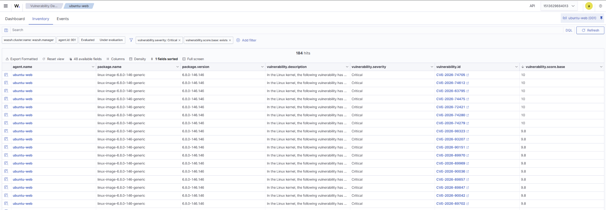

Wazuh displayed `Package default status` as the scanner condition for the first two records. That does **not** establish an exact corrected Ubuntu 24.04 kernel package. Patch availability should be verified against the vendor's advisory for the specific Ubuntu release and kernel flavor.

### 8.2 Windows — highest-scoring selected CVEs

The Windows VM was reported as **Windows 10 Pro, build 19045.3803**.

| CVE | Wazuh CVSS v3.1 | Finding | Wazuh scanner threshold |
| --- | ---: | --- | --- |
| [CVE-2026-57092](https://msrc.microsoft.com/update-guide/vulnerability/CVE-2026-57092) | **9.9** | VMSwitch use-after-free | Build below **19045.7548** |
| [CVE-2025-49708](https://msrc.microsoft.com/update-guide/vulnerability/CVE-2025-49708) | **9.9** | Graphics Component use-after-free | Build below **19045.6456** |
| [CVE-2026-96924](https://msrc.microsoft.com/update-guide/vulnerability/CVE-2026-96924) | **9.8** | Windows OLE pointer vulnerability | Build below **19045.7807** |

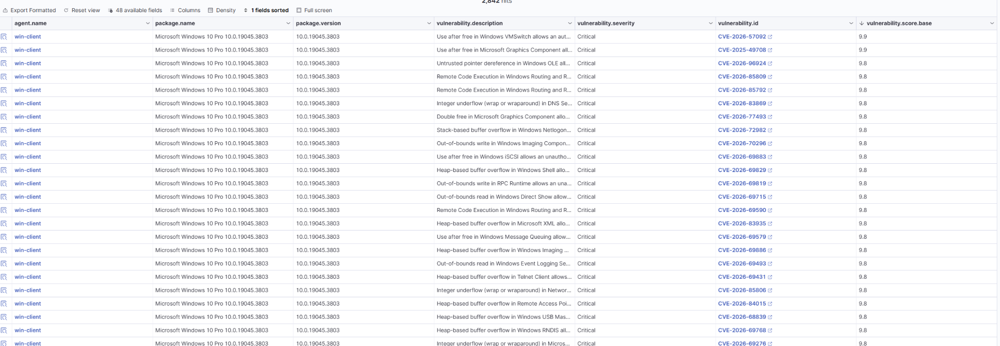

The scanner thresholds are **not proof that patches are installed or available to this particular VM**. Windows 10 servicing/Extended Security Updates (ESU) eligibility and the affected component's actual presence must be considered. The vulnerable-component conditions and practical exploitability were not independently validated.

For the full table, see **[Week 2 security findings](findings.md)**.

---

## 9. Troubleshooting summary

The lab included real configuration errors, which are documented as part of the investigation rather than omitted.

| Issue | Cause | What fixed it |
| --- | --- | --- |
| Wazuh agent XML parse error | Extra/misplaced configuration root caused `junk after document element` | Corrected the XML document structure; logcollector test and restart passed |
| Custom LabShop rule refused to load | Attempted to match `action` as a static Wazuh rule element | Switched to `<field name="action" type="pcre2">`; validation returned 0 |
| Unexpected fallback in `wazuh-logtest` | Two input events were pasted together | Submitted one complete syslog record per line |
| Windows Registry detection seemed delayed | Registry FIM is scheduled, not a real-time folder watcher | Waited for the configured 300-second scan; rule 750 appeared |
| Linux scheduled FIM test too slow | Default scan interval was 43,200 seconds | Temporarily used 60 seconds, tested and restored the original interval |
| Suricata failed to start | The default interface `eth0` did not exist | Configured AF_PACKET to use `ens34` |
| Suricata found no signatures | Default rule path had no usable loaded rule | Created a local `labshop.rules` and added it to the rule file list |
| Windows vulnerability inventory appeared empty | Ubuntu's pinned agent ID `001` conflicted with a Windows filter | Opened the correct `win-client (002)` agent-specific page |

Related implementation screenshots are included directly beside the relevant steps above. See also **[troubleshooting.md](troubleshooting.md)**.

---

## 10. Final validation and VMware snapshots

All three machines were saved with **`w2-start`** and **`w2-done`** VMware snapshots. Earlier Week 1 snapshots were preserved, providing a rollback point for each milestone.

| VM | Snapshot progression |
| --- | --- |
| `siem-host` | `w1-clean-install` → `w1-done` → `w2-start` → **`w2-done`** |
| `ubuntu-web` | `w1-clean-install` → `w1-done` → `w2-start` → **`w2-done`** |
| `win-client` | `w1-clean-install` → `w1-done` → `w2-start` → **`w2-done`** |

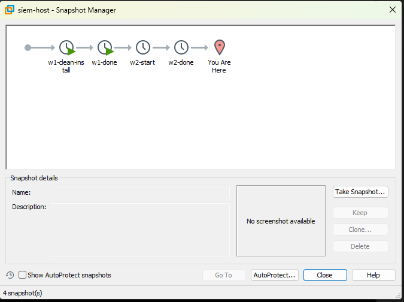

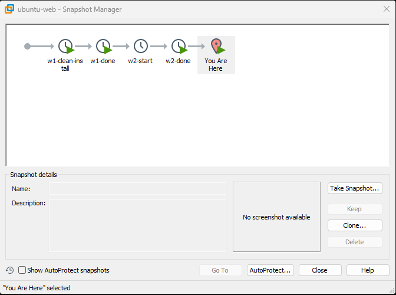

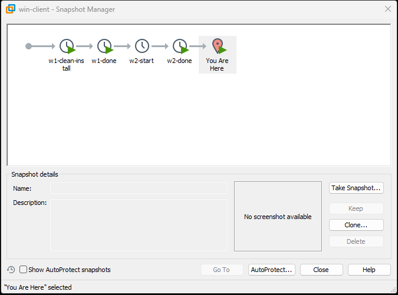

### What was verified

- Individual LabShop authentication failures and same-IP brute-force correlation.
- Linux and Windows file creation, modification, deletion and content changes.
- Scheduled Registry FIM and Linux scheduled FIM.
- Suricata HTTP `/admin` detection and live Wazuh **level-10** alert.
- Successful removal of temporary Ubuntu NAT, leaving the host-only interface.
- Ubuntu SCA improvement after two configuration corrections; Windows SCA and CVE baseline recorded.
- Snapshot restoration points for all VMs.

## Repository files and reproducibility

| Resource | Location |
| --- | --- |
| Wazuh LabShop authentication rules | [`config/rules/labshop_rules.xml`](config/rules/labshop_rules.xml) |
| Wazuh Suricata integration rule | [`config/rules/labshop_suricata_rules.xml`](config/rules/labshop_suricata_rules.xml) |
| Suricata HTTP signature | [`config/suricata/labshop.rules`](config/suricata/labshop.rules) |
| Deployment/configuration notes | [`config/README.md`](config/README.md) |
| Evidence screenshots | [`evidence/`](evidence/) |
| SCA and CVE results | [`findings.md`](findings.md) |
| Troubleshooting notes | [`troubleshooting.md`](troubleshooting.md) |
| A4 step-by-step Word report | [`report/Mini_SOC_Week2_Step_by_Step_A4_Report.docx`](report/Mini_SOC_Week2_Step_by_Step_A4_Report.docx) |

**Documentation limitations.** Only the tested rules and safe configuration excerpts are published. The full custom decoder XML was not supplied as a clean export, so it has not been recreated from guesses. Full agent configurations, Docker Compose secrets, private keys, passwords, and virtual-machine disks are intentionally excluded. Commands reflect a controlled lab, not a production hardening procedure.

---

**Outcome:** Week 2 transformed the Week 1 monitoring stack into a small but functional **detection-and-validation lab** with custom application correlation, endpoint FIM, network IDS telemetry, compliance assessment, and documented vulnerability findings.

[⬆ Back to project homepage](../README.md)
